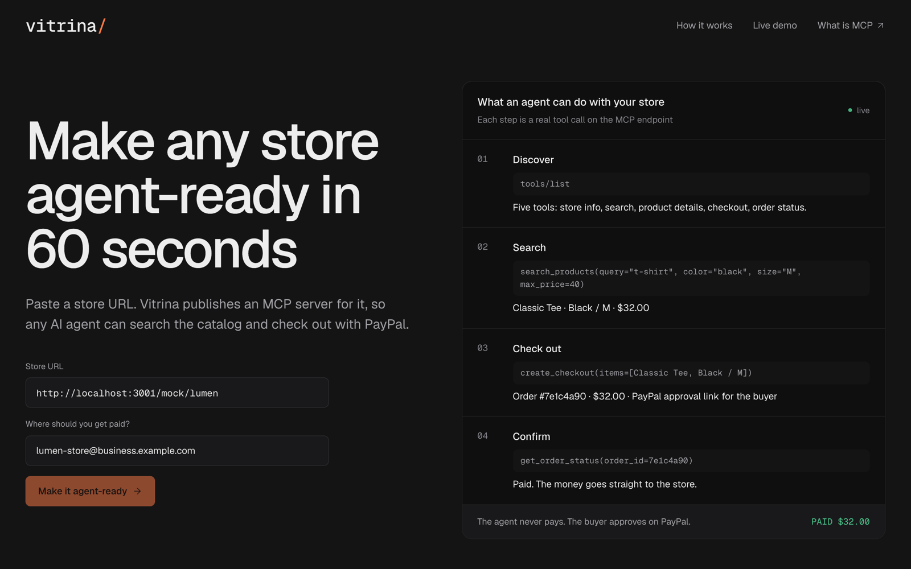
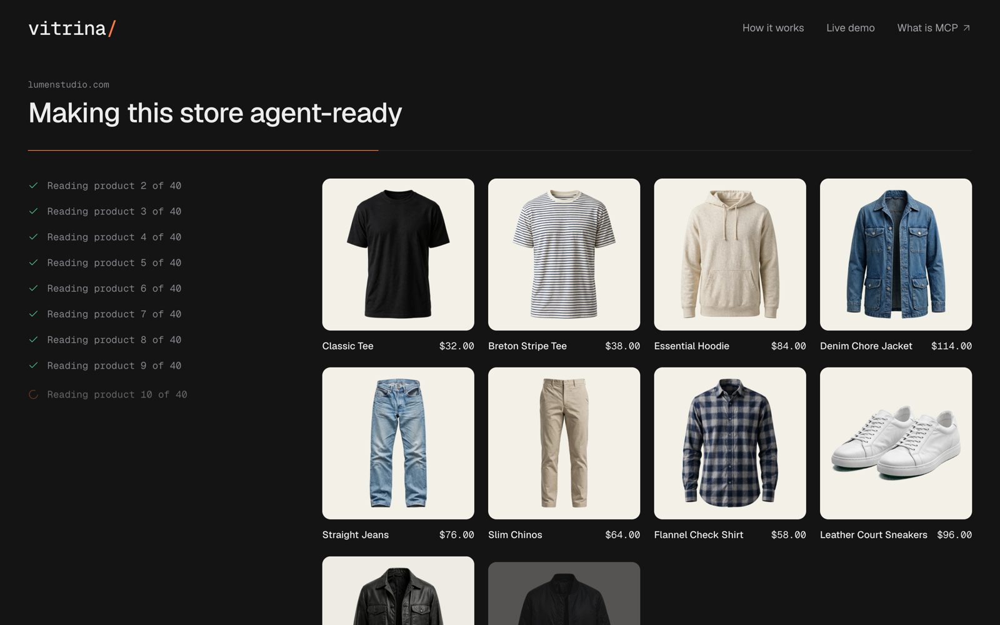
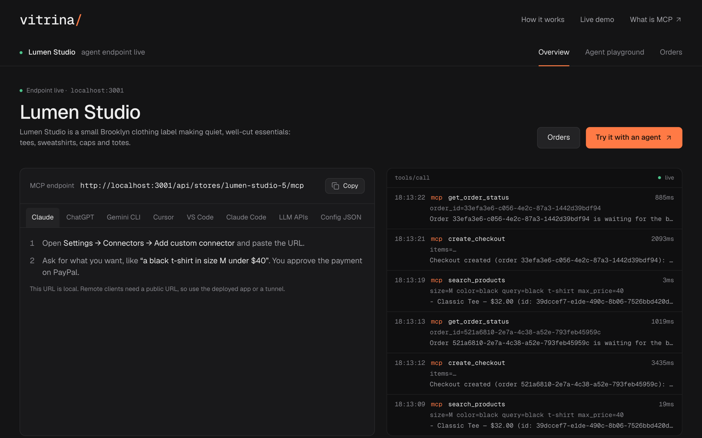
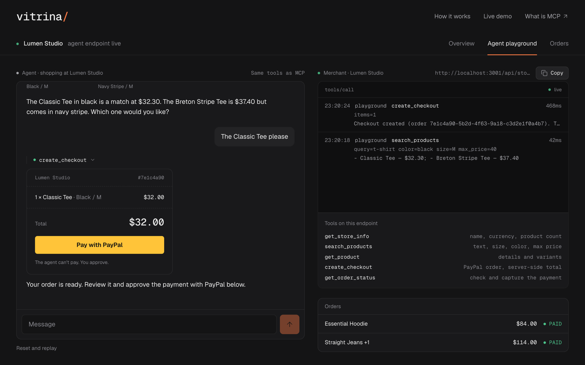
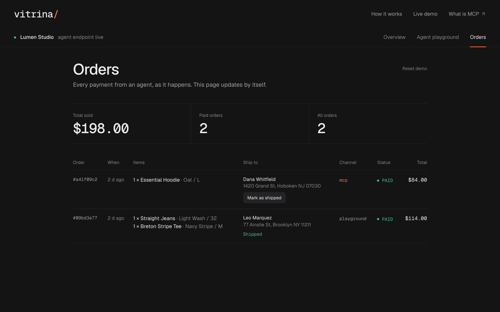
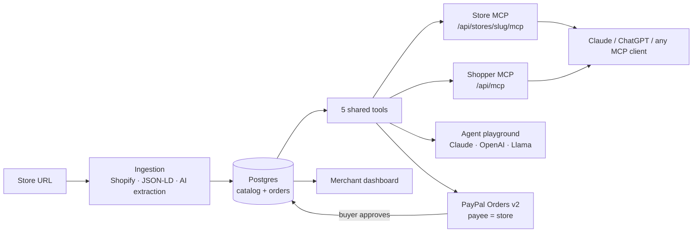

# Vitrina

**Make any small online store agent-ready in 60 seconds.**

Paste a store URL. Vitrina reads the site, builds a structured catalog and publishes an **MCP server** for it, wired to **PayPal**. Any AI assistant can then search the catalog, build an order and send the buyer to PayPal. The money goes straight to the store's PayPal account, and a human always approves the payment.



## Why

Agentic commerce is arriving through big platforms. The small store that sells through Instagram, Tiendanube or a hand-built site has no API, no product feed and no checkout an agent can call, so agents never find it.

Vitrina closes that gap with no integration work from the merchant: a URL becomes a catalog, an MCP endpoint and a PayPal checkout. Agents shop, humans approve.

## How it works

**1. Read the store.** Vitrina uses the Shopify catalog when there is one, then structured data (JSON-LD), and otherwise reads each product page with an LLM and validates the result against a schema.



**2. Publish an MCP endpoint.** Each store gets its own MCP server with five tools: `get_store_info`, `search_products`, `get_product`, `create_checkout` and `get_order_status`. The store page shows the URL, setup steps for Claude, ChatGPT, Cursor, VS Code and more, and a live log of every tool call.



**3. Let an agent shop.** Any MCP client can use those tools. The built-in Agent playground runs the same tools with the model you configure. The agent finds the product, builds the order and stops at the PayPal button, because only the buyer can pay.



**4. Get paid and ship.** The payment lands in the store's PayPal account. The order appears live in the merchant's dashboard with the buyer's shipping address from PayPal, and the merchant marks it as shipped.



Shoppers can also add one MCP server for every store at once: `/api/mcp` searches across all Vitrina stores and routes each checkout to the store that owns the product.

## Architecture



Stack: Next.js 15, TypeScript, Drizzle + Postgres, Zod, the MCP TypeScript SDK (Streamable HTTP) and the PayPal Orders v2 API.

## PayPal

- **Orders v2.** `create_checkout` creates an order with `intent: CAPTURE`. Totals are computed on the server from catalog prices, never from what the agent says.
- **Payee routing.** `payee.email_address` is the store's PayPal email, so funds go directly to the merchant.
- **Human approval.** In the playground the buyer pays with the PayPal button. External agents return PayPal's approval link, and `/checkout/return` captures the order after the buyer approves.
- **Safe capture.** A paid order is never captured twice.
- **Shipping.** The buyer picks the address inside PayPal. Vitrina saves it on the order for the merchant, and the agent never sees the card or the address.
- **Webhooks.** `POST /api/webhooks/paypal` verifies signatures and syncs approvals and captures.

## AI providers

Vitrina is model-agnostic. Set `AI_PROVIDER` to choose:

| `AI_PROVIDER` | Default model |
|---|---|
| `anthropic` | `claude-opus-5-5` |
| `openai` | `gpt-5.5` |
| `llama` | `Llama-4-Maverick-17B-128E-Instruct-FP8` |

AI powers catalog extraction for plain-HTML stores and the Agent playground. The MCP endpoints don't need it, because the MCP client brings its own model.

## Run it

You use **your own** keys and accounts: a PayPal sandbox REST app, a sandbox Business account (receives payments) and a sandbox Personal account (pays), one AI provider key and a Postgres database.

```bash
docker compose up -d
cp .env.example .env.local   # fill in your keys
pnpm i
pnpm db:migrate
pnpm dev
```

Open http://localhost:3000, click **Use demo store**, enter your sandbox Business email and press **Make it agent-ready**. Then open **Try it with an agent**, ask for "a black t-shirt in size M under $40" and pay with your sandbox Personal account.

| Variable | Purpose |
|---|---|
| `DATABASE_URL` | Postgres connection string |
| `AI_PROVIDER` | `anthropic`, `openai` or `llama` |
| `ANTHROPIC_API_KEY` / `OPENAI_API_KEY` / `LLAMA_API_KEY` | Key for the chosen provider. Models can be overridden with `*_MODEL` |
| `PAYPAL_CLIENT_ID` / `PAYPAL_CLIENT_SECRET` | Sandbox REST app credentials |
| `NEXT_PUBLIC_PAYPAL_CLIENT_ID` | Same client id, for the PayPal button |
| `PAYPAL_WEBHOOK_ID` | Webhook signature verification |
| `APP_URL` | Public base URL, used in MCP URLs and PayPal return links |
| `FX_RATES_JSON` | Fixed rates to USD, e.g. `{"ARS":0.00085}` |

**PayPal sandbox:** at [developer.paypal.com](https://developer.paypal.com/dashboard), open **Testing tools → Sandbox accounts** to get a Business and a Personal account, then **Apps & Credentials → Sandbox** to create an app and copy its client id and secret.

Scripts: `pnpm test`, `pnpm lint`, `pnpm typecheck`, and `pnpm smoke`, which runs a full ingest → MCP → PayPal checkout against the running app.

## Connect an agent

In Claude, open **Settings → Connectors → Add custom connector** and paste `{APP_URL}/api/mcp` (every store) or a store's own URL from its page. The URL must be publicly reachable, so use the deployed app or a tunnel. Then ask: "Find me a black t-shirt in size M under $40 and check it out."

## Deploy

`render.yaml` is a Render Blueprint. Use an external Postgres (for example Neon), set `APP_URL` to the Render URL and add your keys. Migrations run before each deploy.

## License

MIT
